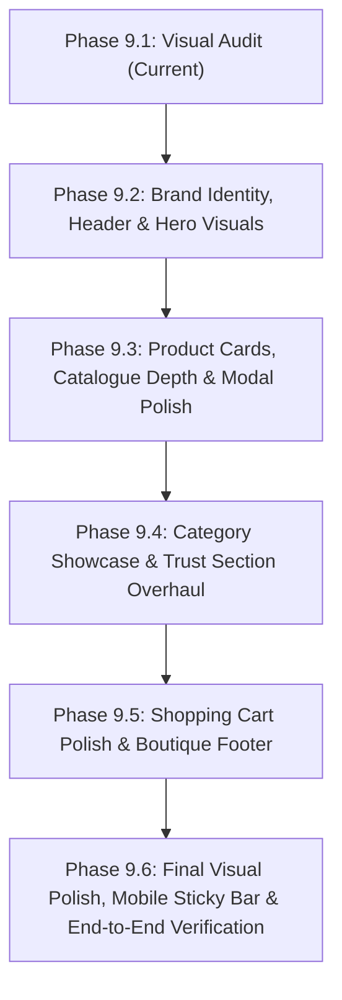

# Phase 9.1: Abhi Saree Collection Visual & Aesthetic Audit

**Target Application**: `D:\Abhi_Sareee\app\`  
**Audit Date**: October 15, 2026  
**Auditor**: Antigravity Assistant (Pair Programming with User)  
**Scope**: Full visual, aesthetic, typography, layout, content, and branding audit across Desktop (1280px/1440px), Tablet (768px), and Mobile (375px).  
**Phase Nature**: **Audit-only**. No code modifications, package installations, or functional changes have been applied.

---

## Executive Summary

The React application inside `app/` is functionally rock-solid. It achieves 100% test pass rates across search, filtering, focus-trapped modals, a pure `useReducer` cart, and URL-encoded WhatsApp ordering.

However, from an **e-commerce customer experience and luxury boutique aesthetic standpoint**, the website currently presents as an **early-stage engineering prototype** rather than an inviting, high-end Indian saree boutique. It is characterized by placeholder SVG graphics, developer notices, missing real-world business contact details, a bare single-line footer, unpopulated categories, and a lack of visual storytelling or real saree photography.

This audit details what prevents the site from looking complete and polished, categorizes findings across all 10 areas of the site, ranks problems by severity, provides component-level recommendations, and proposes a phased roadmap for implementation.

---

## 1. Current Strengths

Before addressing deficiencies, the application has established several strong foundational assets:

1. **Elegant Core Color Palette**: The brand palette—Warm Ivory (`#FAF6F0`), Deep Maroon (`#6B1E2B`), Antique Gold (`#C9A15C`), and Charcoal (`#2B2523`)—is authentic, culturally resonant, and well suited for an Indian handloom saree house.
2. **Refined Typography Pairing**: Combining *Playfair Display* for headings and *Poppins* for body text and interactive controls provides good contrast between classical editorial luxury and crisp modern legibility.
3. **Flawless Technical Architecture**: Zero console errors, zero React warnings, zero layout overflow on 10 viewports (`320px` to `1440px`), and full keyboard accessibility.
4. **Predictable Cart & WhatsApp Checkout Flow**: The itemized WhatsApp cart summary and product enquiry URLs are accurately constructed and formatted in Indian Rupees (`en-IN`).
5. **Authentic Circular Brand Logo**: The official brand mark in the header establishes brand continuity with the boutique's physical heritage.

---

## 2. Problems Ranked by Severity

### Critical (Destroys customer purchasing trust and credibility)
1. **Geometric SVG Placeholders Instead of Real Saree Photography**: Saree shopping is an intensely tactile, visual, and aesthetic decision. Customers look for pallu drape, border zari texture, fabric fall, and true-to-life dye hues. The current geometric SVG shapes with "SAMPLE PRODUCT PREVIEW" text make the boutique feel like an unlaunched wireframe.
2. **Missing Real Business & Contact Details in Footer**: The footer is currently a single centered line with only a copyright string. It contains no boutique physical address, city, landline/mobile number, direct WhatsApp link, email, opening hours, or Google Maps link. For high-value sarees (₹4,250 – ₹11,999), an anonymous footer deters prospective buyers.
3. **Pervasive Developer & Sample Showcase Notices**:
   - Collection header: `* Sample showcase: items and reference prices are displayed for design demonstration.`
   - Product cards and modal: `Sample Reference` badges.
   - Cart summary: `* Sample showcase order demonstration with pure useReducer state management.`
4. **"Customer Trust Placeholder" in the Testimonial Section**: Card 2 in the trust section is explicitly titled *"Verified Buyer Reviews"* with text reading: *"Sample Testimonial Slot: Customer reviews from verified buyers will be highlighted here in future updates"*. Having a placeholder inside a section intended to build customer trust has the opposite effect.
5. **Absence of a Real Hero Visual Banner**: The top of the homepage consists solely of centered text on ivory and a test button. There is no evocative hero image, no drape showcase, no seasonal campaign banner, and no primary call-to-action button (e.g. "Explore Festive Sarees" or "Chat with Boutique Stylist").

### High (Severely detracts from luxury boutique feel)
6. **75% of Category Cards Marked "IN PREPARATION"**: Under "Explore by Category", 3 out of 4 cards (Suits, Blouses, Other Clothing) are unclickable text boxes reading *"CATALOG IN PREPARATION"*. None of the cards feature imagery. This gives the impression of a mostly closed store.
7. **Boutique Status Checker Misplaced as Main Hero Element**: The "Check Boutique Status" button and interactive message box occupy the focal point of the welcome section. This feels like an engineering test harness rather than an elegant boutique opening-hours badge.
8. **Small 4-Product Catalogue with Missing Specifications**: The collection has only 4 sarees, each with a single-line generic description. Real saree buyers require: length (5.5m + 0.8m unstitched blouse piece), pure silk certification/mark, zari authenticity (tested/metallic/pure gold), wash care (Dry Clean only), and occasion advice.
9. **No Instagram or Social Media Presence**: Modern Indian boutique shoppers heavily rely on Instagram reels and styling posts. The site has no Instagram link, social handle, or gallery feed.
10. **Desktop Header Lacks Sticky Navigation, Quick Contact, and Cart Icon**: The header scrolls completely out of view. The Cart link is plain text without an icon, and there is no direct "WhatsApp Us" button in the top bar.

### Medium (Aesthetic inconsistencies & layout friction)
11. **Dashed Gold Card Borders Look Like Coupons/Wireframes**: Product cards and trust cards feature dashed gold borders (`border: 1.5px dashed var(--color-antique-gold)`). In luxury retail, solid subtle borders, soft drop shadows, or clean linen framing look vastly more premium.
12. **Mobile Category Filter Ragged Wrap**: At 375px, the 4 filter pills ("All", "Silk", "Cotton", "Georgette") wrap awkwardly, leaving "Georgette" isolated and centered on a second line.
13. **Generic Blue Shopping Bags Emoji in Empty Cart**: The empty cart uses `🛍️`. A bespoke gold-line SVG icon (such as an embroidered tote or handloom shuttle) would fit the boutique aesthetic much better.
14. **Lack of Alternating Section Contrast**: The entire page uses `#FAF6F0` (warm ivory) continuously from top to bottom. Without subtle alternating backgrounds (e.g., pure white `#FFFFFF` or soft linen cream `#F4EFE6`), sections bleed into one another.
15. **Abrupt WhatsApp Green without Integrated Brand Accents**: The WhatsApp green (`#128C7E`) button appears abruptly next to deep maroon buttons without official WhatsApp icon vectors or integrated styling.

### Low (Micro-styling & polish opportunities)
16. **Button Border Radius Inconsistency**: Mix of sharp 6px, rounded 8px, and pill-shaped 24px across different interactive elements.
17. **Product Detail Modal Lacks Multi-Angle Imagery**: Only one image is shown in the modal; sarees typically require at least a full drape shot, a close-up pallu weave shot, and a blouse piece view.
18. **Mobile Navigation Drawer Plainness**: The drawer is a plain list of text links without boutique address, phone number, or opening hours.
19. **Missing Sticky Bottom Bar on Mobile**: Mobile shoppers benefit from a quick sticky footer with "Cart (X items) | WhatsApp Enquiries".

---

## 3. Section-by-Section Findings

### 3.1 Header, Logo, Navigation, and Mobile Menu
- **Visual Reality**: The header contains the 56px circular logo, brand name, and standard horizontal links. It sits on white background with an antique gold bottom border.
- **Deficiencies**:
  - Logo is static and small; lacks a subtitle like *"Handlooms & Bridal Boutique"*.
  - Navigation has no active scrollspy state indicating which section is in view.
  - Cart link has a badge, but no icon (`🛒` or SVG bag).
  - Header is not sticky; scrolling down makes the user lose access to navigation and cart.
  - Mobile menu drawer is plain white with horizontal lines, lacking boutique contact details or warmth.

### 3.2 Hero / Welcome Section & Primary CTA
- **Visual Reality**: Centered title *"Welcome to Abhi Saree Collection"*, two sentences of description, and a bordered box with a *"Check Boutique Status"* button.
- **Deficiencies**:
  - Completely text-heavy with zero imagery.
  - No primary CTA button directing users to the saree collection or WhatsApp styling.
  - Looks like an administrative notice rather than the entrance to an opulent saree showroom.

### 3.3 Featured Collection, Search Bar, and Category Filters
- **Visual Reality**: Centered collection heading with an italic sample disclaimer below it. Below is the search input, result count, and 4 filter buttons.
- **Deficiencies**:
  - The sample disclaimer (`* Sample showcase...`) undermines the commercial validity of the shop.
  - Search input has no search magnifying glass icon inside the box; looks like a generic web form input.
  - Filter pills wrap unevenly on mobile viewports ($\le 390\text{px}$).
  - Result count ("Showing 4 of 4 sarees") sits between search and filters rather than docking neatly beside them.

### 3.4 Product Cards, Images, Prices & Detail Modal
- **Visual Reality**: 4 product cards in a 4-column desktop grid / 1-column mobile stack. Each has an SVG placeholder, category tag, title, description, price with "Sample Reference", and two buttons ("View Details" and "Add to Cart").
- **Deficiencies**:
  - Geometric SVGs must be replaced with real saree photography.
  - Dashed borders look like coupons or placeholder boxes.
  - "Sample Reference" tag is displayed right next to the price on every card.
  - "View Details" button takes equal visual weight to "Add to Cart". "Add to Cart" should be the dominant primary action, with "View Details" as a secondary link or card click action.
  - Modal provides only 1 preview image, generic text, and a sample notice badge. Lacks structured specification tables (Length, Blouse Piece, Zari Type, Wash Care).

### 3.5 Shopping Cart, Quantity Controls, and WhatsApp Ordering
- **Visual Reality**: Empty cart card with emoji `🛍️`, browse button, and disabled WhatsApp button. Populated cart displays item cards with quantity controls, subtotal, and summary card with "Order on WhatsApp" and "Clear Cart".
- **Deficiencies**:
  - Developer notice in summary footer: `* Sample showcase order demonstration with pure useReducer state management.`
  - Disabled WhatsApp button in empty cart occupies unnecessary visual prominence.
  - Grand total digits use Playfair Display serif numbers that can look slightly misaligned with standard tabular figures.
  - Quantity control buttons (`+` and `−`) are small and feel cramped on touchscreens.

### 3.6 Category Highlights ("Explore by Category")
- **Visual Reality**: 4 cards: Sarees, Suits, Blouses, Other Clothing.
- **Deficiencies**:
  - 3 of the 4 cards have `CATALOG IN PREPARATION` and are unclickable.
  - Zero photographic imagery or icons; just text in white cards.
  - Makes the store appear 75% unstocked.

### 3.7 Customer Trust Section ("Why Choose Abhi Saree Collection")
- **Visual Reality**: 3 cards: Handpicked Authenticity, Verified Buyer Reviews, Care & Delivery.
- **Deficiencies**:
  - Middle card has an explicit `CUSTOMER TRUST PLACEHOLDER` badge and placeholder text.
  - Dashed card border around the placeholder card calls further attention to its unfinished state.
  - Cards lack real customer quotes, city locations, or verified purchase indicators.

### 3.8 Boutique Status & Opening Hours
- **Visual Reality**: A standalone box in the hero section with a button that toggles a message saying the boutique is open today.
- **Deficiencies**:
  - Placed awkwardly in the hero instead of an announcement bar or the footer/contact section.
  - Lacks concrete opening hours (e.g. *10:30 AM – 8:30 PM, Monday to Sunday*).
  - Lacks physical location context (e.g. *Boutique at Sarafa Bazaar / MG Road*).

### 3.9 Footer, Address, Contact & Social Links
- **Visual Reality**: Single-line copyright footer: `© 2026 Abhi Saree Collection. All rights reserved.`
- **Deficiencies**:
  - No physical boutique address.
  - No phone number.
  - No email or WhatsApp link.
  - No Instagram profile link.
  - No business hours or location map link.
  - No customer service links (Shipping & Delivery, Handloom Authenticity, Care Guide).

### 3.10 Mobile, Tablet, and Desktop Responsiveness
- **Desktop**: Content feels like floating blocks on a vast ivory plane; lacks luxury framing or visual rhythm.
- **Tablet (768px)**: 2-column grid works well, but Category Highlights (4 cards) and Trust cards (3 cards) create asymmetrical 2-item rows with awkward bottom spacing.
- **Mobile (375px)**:
  - Long vertical scroll due to 550px+ card height.
  - Filter pills wrap unevenly.
  - No sticky mobile bar for fast access to Cart or WhatsApp.

---

## 4. Recommended UI Improvements & Component References

| Component | File Reference | Recommended UI Transformation |
| :--- | :--- | :--- |
| **Top Announcement Bar** | [`Header.jsx`](file:///d:/Abhi_Sareee/app/src/components/Header.jsx) | Add an elegant top notification strip in deep maroon: *"Festive Handloom Showcase • Boutique Visits & Nationwide Delivery • Order on WhatsApp: +91 93402 63875"*. |
| **Sticky Boutique Header** | [`Header.jsx`](file:///d:/Abhi_Sareee/app/src/components/Header.jsx), [`App.css`](file:///d:/Abhi_Sareee/app/src/App.css) | Make header sticky on scroll with a subtle shadow; add a boutique subtitle under brand name, and add an SVG shopping bag icon to the Cart link. |
| **Visual Hero Showcase** | [`WelcomeSection.jsx`](file:///d:/Abhi_Sareee/app/src/components/WelcomeSection.jsx) | Replace plain text with a rich hero layout: atmospheric background, refined headline, boutique value pillars (Pure Weaves, Direct Weavers, Worldwide Shipping), and a dual CTA: "Explore Collection" and "WhatsApp Enquiry". Move status checker to header/contact. |
| **Search & Filter Controls** | [`ProductSearch.jsx`](file:///d:/Abhi_Sareee/app/src/components/ProductSearch.jsx), [`CategoryFilter.jsx`](file:///d:/Abhi_Sareee/app/src/components/CategoryFilter.jsx) | Embed an SVG magnifying glass icon in the search field. Style filter pills with a horizontal scrollable row on mobile (`overflow-x: auto`) to avoid ragged line wraps. Remove sample disclaimers. |
| **Product Cards** | [`ProductCard.jsx`](file:///d:/Abhi_Sareee/app/src/components/ProductCard.jsx), [`App.css`](file:///d:/Abhi_Sareee/app/src/App.css) | Replace dashed borders with clean 1px solid borders and soft elevation hover. Make "Add to Cart" the dominant button. Replace "Sample Reference" tag with authentic fabric badges (e.g. "Pure Katan Silk", "GI Handloom Weave"). |
| **Product Detail Modal** | [`ProductDetailModal.jsx`](file:///d:/Abhi_Sareee/app/src/components/ProductDetailModal.jsx) | Add a structured specification grid (Length: 6.3m with blouse, Weave: Kadwa Zari, Care: Dry Clean Only). Add WhatsApp icon to the enquiry button. Remove sample disclaimers. |
| **Shopping Cart Experience** | [`ShoppingCart.jsx`](file:///d:/Abhi_Sareee/app/src/components/ShoppingCart.jsx) | Replace `🛍️` emoji with an elegant gold handloom SVG icon. Remove developer notices. Redesign summary card with clear line items, delivery note ("Free insured shipping across India"), and branded WhatsApp order button with icon. |
| **Category Highlights** | [`CategoryHighlights.jsx`](file:///d:/Abhi_Sareee/app/src/components/CategoryHighlights.jsx) | Add curated visual preview imagery or textured handloom background patterns. Refine "In Preparation" status to an elegant "Coming This Season" preview with notify links. |
| **Customer Trust & Proof** | [`CustomerTrust.jsx`](file:///d:/Abhi_Sareee/app/src/components/CustomerTrust.jsx) | Replace the placeholder card with authentic boutique craftsmanship pillars: *1. Handpicked Weaves, 2. Pure Zari & Silk Authenticity, 3. Personalized Styling & Doorstep Delivery*. Remove all placeholder mentions. |
| **Rich Boutique Footer** | [`Footer.jsx`](file:///d:/Abhi_Sareee/app/src/components/Footer.jsx) | Expand from a 1-line copyright into a multi-column boutique footer: (1) Brand Heritage, (2) Boutique Address & Visit Timings, (3) Direct Contact & WhatsApp, (4) Instagram Profile & Quick Navigation. |

---

## 5. Required Real Business Content & Assets Missing

To transition from an engineering showcase to a fully credible boutique website, the following real-world assets and business information should be provided by the boutique owner:

### 1. Visual Assets (Product Photography)
- High-resolution photographs for the 4 featured sarees (preferably portrait 3:4 or 4:5 ratio, showing the full drape, pallu detail, and fabric texture).
- Visual banner image for the Hero section showcasing celebratory handloom sarees.
- Visual preview images or textures for the 4 category cards (Sarees, Suits, Blouses, Other Clothing).

### 2. Business & Contact Information
- **Boutique Physical Address**: Full address including street, landmark, area, city, and PIN code.
- **Opening Timings**: e.g., *Monday – Sunday: 10:30 AM to 8:30 PM*.
- **Contact Numbers**: Primary calling number and WhatsApp concierge number (currently confirmed: `919340263875`).
- **Official Email**: e.g., `contact@abhisareecollection.com` or boutique Gmail.
- **Instagram Handle**: Official boutique profile link (e.g., `@abhisareecollection`).
- **Google Maps Direction Link**: For local customers visiting the boutique.

### 3. Boutique Value Pillars (Authentic Replacement for Placeholder Testimonial)
- Real customer testimonials or verified craftsmanship commitments (e.g. Silk Mark certified, traditional handloom weaving clusters, artisanal quality guarantee).

---

## 6. Proposed Phased Implementation Order

To maintain strict code quality, zero regression, and comprehensive test coverage, UI upgrades should be implemented in logical, self-contained subphases:

### **Phase 9.2: Header, Brand Identity & Hero Visual Transformation**
- Add top announcement bar with boutique hours and WhatsApp phone number.
- Make header sticky with smooth elevation shadow on scroll.
- Add shopping bag SVG icon and total count to the Cart nav item.
- Transform the Hero/Welcome section with an evocative boutique banner, tagline, dual CTA buttons ("Explore Saree Collection" and "WhatsApp Styling Concierge"), and move the boutique status checker into a polished live badge.

### **Phase 9.3: Product Cards, Modal Specs & Visual Polish**
- Integrate authentic product imagery (or high-fidelity boutique handloom visuals).
- Replace dashed gold borders with solid boutique borders and gentle hover elevation.
- Remove all "Sample Reference" labels and showcase notices.
- Add structured saree specifications (Fabric, Length, Blouse, Zari, Wash Care) to the detail modal.
- Optimize search bar with magnifying glass icon and make mobile filter pills scroll horizontally.

### **Phase 9.4: Category Showcase & Trust Section Overhaul**
- Upgrade "Explore by Category" cards with rich background imagery or textures, removing unclickable "In Preparation" tags.
- Replace the "CUSTOMER TRUST PLACEHOLDER" with authentic craftsmanship and service guarantees (Silk Authenticity, Handpicked Weavers, Worldwide Insured Shipping).
- Remove all placeholder disclaimers.

### **Phase 9.5: Cart Polish & Rich Boutique Multi-Column Footer**
- Replace the blue emoji `🛍️` in the empty cart with a custom boutique handloom vector icon.
- Remove developer notices from the cart summary.
- Add delivery and care highlights ("Complimentary insured delivery", "Safe packaging").
- Build the rich multi-column boutique Footer with real physical address, contact details, WhatsApp button, Instagram link, and boutique opening hours.

### **Phase 9.6: Mobile Optimization & Final Visual Verification**
- Add sticky mobile bottom action bar ("View Cart" / "WhatsApp Us").
- Verify responsive layout, contrast ratios, and typography scale across all 10 viewports.
- Run complete test suite and linter to ensure 100% regression pass rate.

---

## 7. Stop Condition & Approval Request

Phase 9.1 Visual Audit is complete. No application code has been modified, no packages installed, and no changes made to the root website or `react-practice/`.

The application remains live and functional on `http://localhost:5175/`. Awaiting your review and approval before proceeding to any implementation phase.
